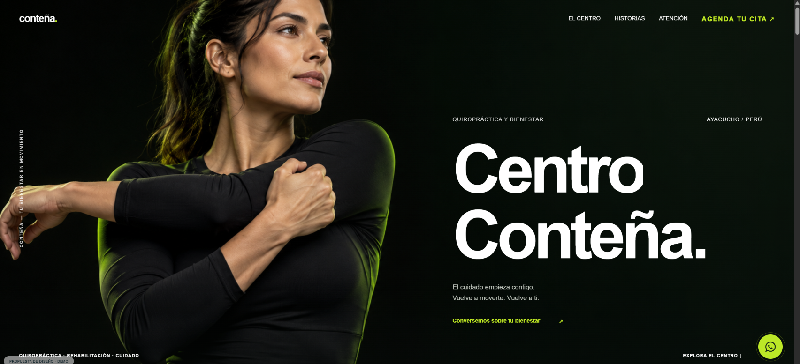

# Centro Conteña — Propuesta de rediseño

Sitio estático con animaciones de desplazamiento, galería, testimonios en video, Google Maps y contacto por WhatsApp.

## Uso

Abre index.html en un navegador. Se requiere conexión a internet para las fotografías del centro, videos y mapa.

También puede servirse con cualquier servidor estático o GitHub Pages desde la raíz del repositorio.

## Contenido

- index.html: diseño, estilos y comportamiento; incluye la portada para facilitar su distribución.
- portada-editorial.png: imagen conceptual creada con IA para la propuesta.

Las fotografías y videos del centro se cargan desde centrocontena.com. La portada es conceptual y no representa a una paciente real. Esta propuesta no sustituye el sitio original.
